# 湘学伴 · 基于大语言模型 Agent 的专升本个性化自适应学习系统

面向湖南专升本（高等数学 / 大学英语 / 计算机基础）的个性化辅导系统：答疑解惑带知识库出处、错题自动生成 L1/L2/L5 变式、三科独立教师风格、跨科目全局画像与情感路由、内置 149 题评测集与四组消融实验。

> **毕业设计速览**：本系统把「大模型 Agent + RAG」用到专升本复习的三个核心环节——**答疑**（先查教材再回答、标注出处、超纲明确提示）、**错题**（粘贴即入库、自动生成同类变式、做完整理回写）、**练习**（按考纲组卷机考 + 拍照批改）。手写 Agent Loop（最多 5 轮工具调用）+ 8 个业务工具；RAG 采用「查询改写 → 向量/全文双路召回 → RRF 融合 → 精排」链路。知识库来自数学、英语教材逐页转录（合计约 76 万字）。配套 149 题评测集与四组消融实验验证效果。详见下方各章节。

> 技术栈：Vue 3 + TypeScript + Vite + Pinia / Fastify + TypeScript + Zod / PostgreSQL 16 + pgvector / 大模型（OpenAI 兼容协议，当前配置智谱 GLM，可切换 DeepSeek 等）/ SSE。

---

## 📱 在线演示（安卓 / 手机可直接打开）

> **无需安装，手机浏览器直接访问即可体验完整功能。**

- **演示地址**：`https://oils-programs-vegas-finals.trycloudflare.com`
- **演示账号**：见下方「访问方式」说明（账号密码由服务端 `.env` 配置，仓库中不含明文凭据）

**安卓端访问方式**（三选一，推荐第 1 种）：

1. **手机浏览器打开上面的网址** → 输入账号密码登录 → 即可使用全部功能。可点浏览器菜单「添加到主屏幕」，获得类似 App 的全屏体验。
2. 若在本地运行：手机与电脑连同一 WiFi，浏览器打开 `http://<电脑局域网IP>:4173`（如 `http://10.x.x.x:4173`）。
3. 本系统为 **Web 应用**，前端 Vue 3 + 后端 Fastify，安卓端通过浏览器 / WebView 容器访问，无需单独开发原生 App。

> ⚠️ 演示地址基于 Cloudflare 临时隧道，域名在隧道重启后会变化；本地演示时请保持电脑开机、后端（8849）与预览服务（4173）运行。

### 界面预览

| 答疑解惑（带出处） | 错题本 |
|---|---|
| 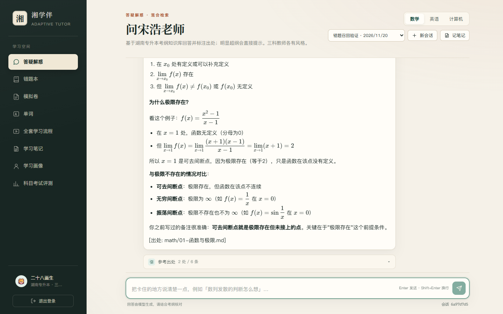 | 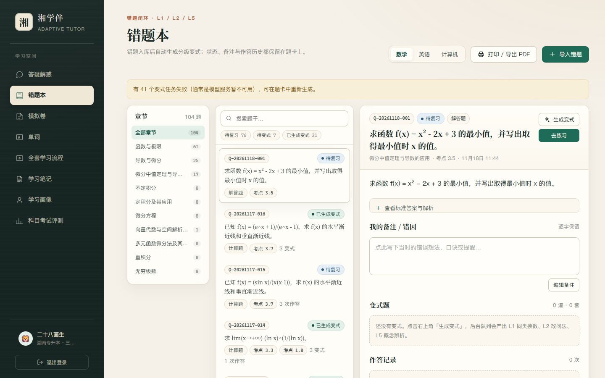 |

| 模拟卷（答题卡机考） | 单词趣味记忆（故事） |
|---|---|
| 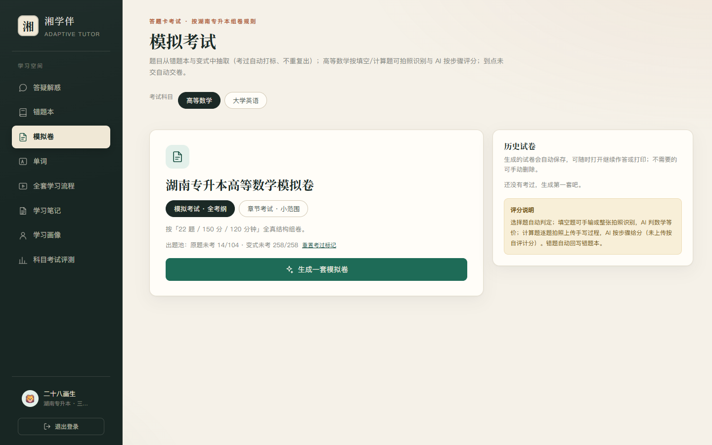 | 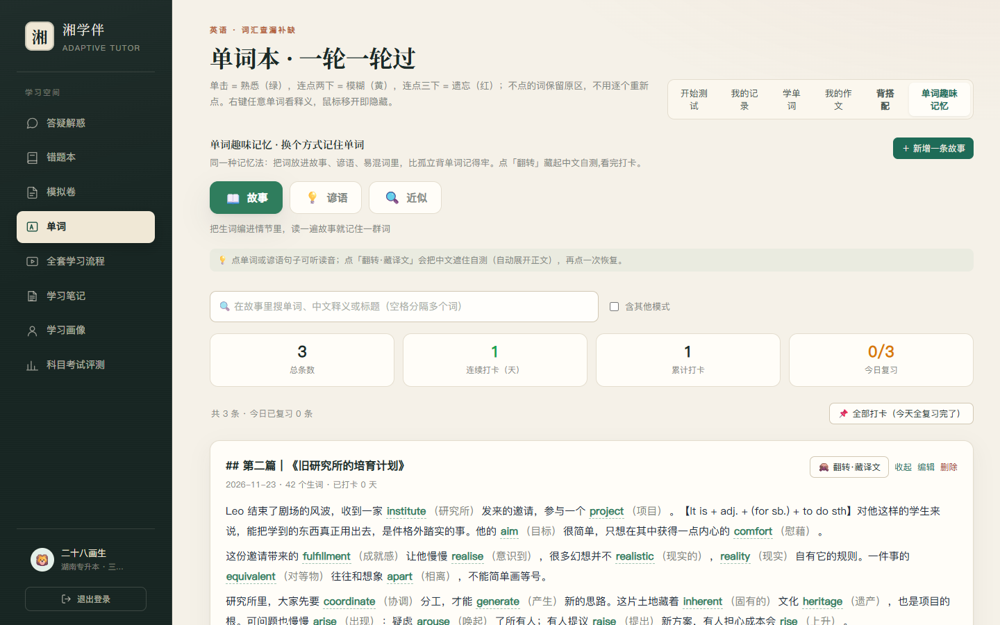 |

| 单词趣味记忆（谚语） | 单词趣味记忆（近似词） |
|---|---|
| 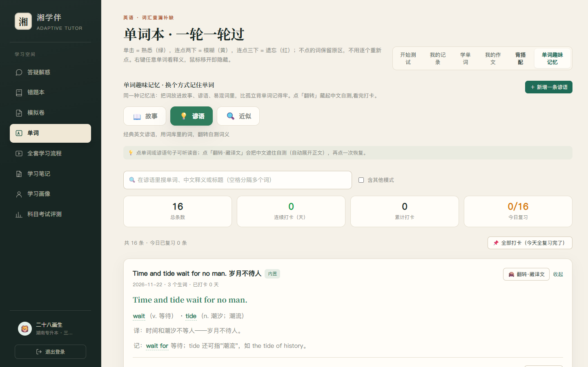 | 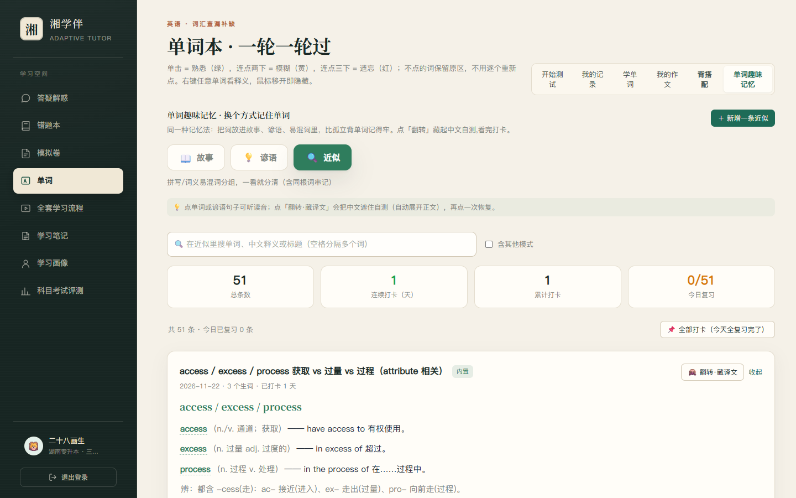 |

| 翻转藏译自测（点词朗读） | 背搭配（固定搭配卡片） |
|---|---|
| 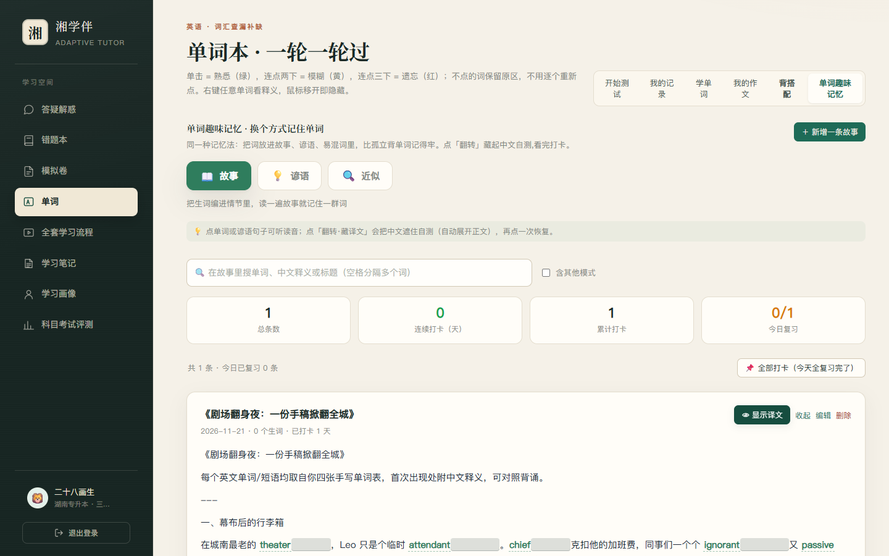 |  |

| 学习笔记（数学 · 活页纸） | 学习笔记（英语 · 活页纸） |
|---|---|
| 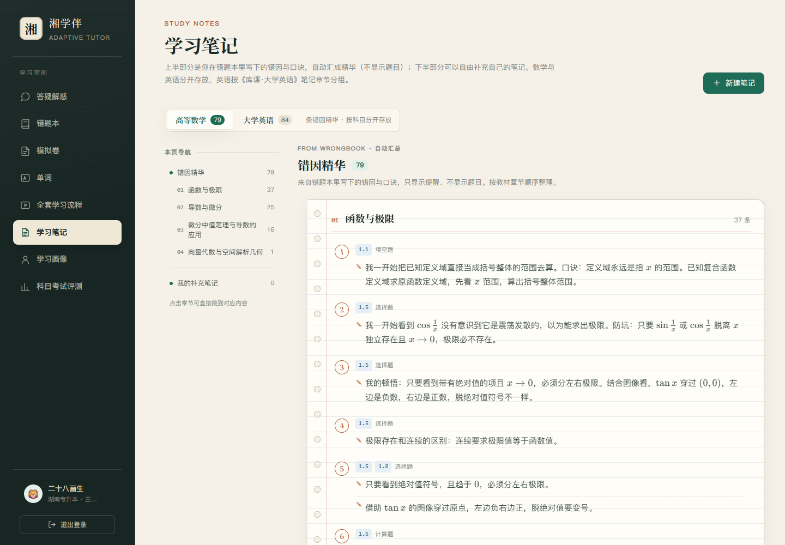 | 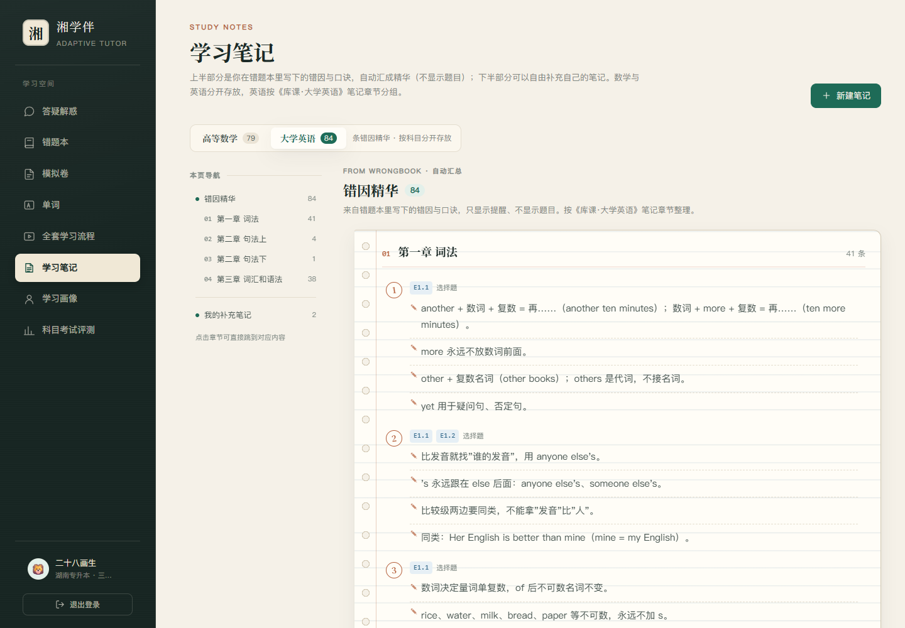 |

| 学习画像 | 个人主页（配置） |
|---|---|
| 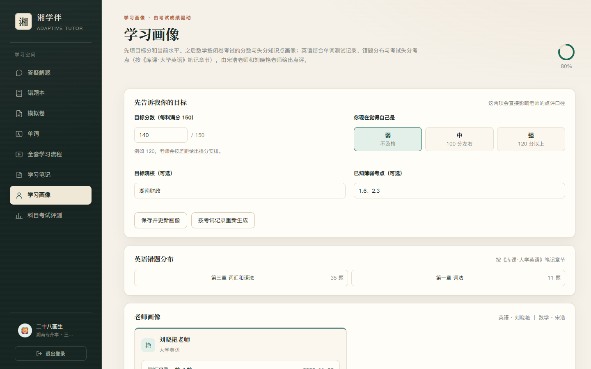 | 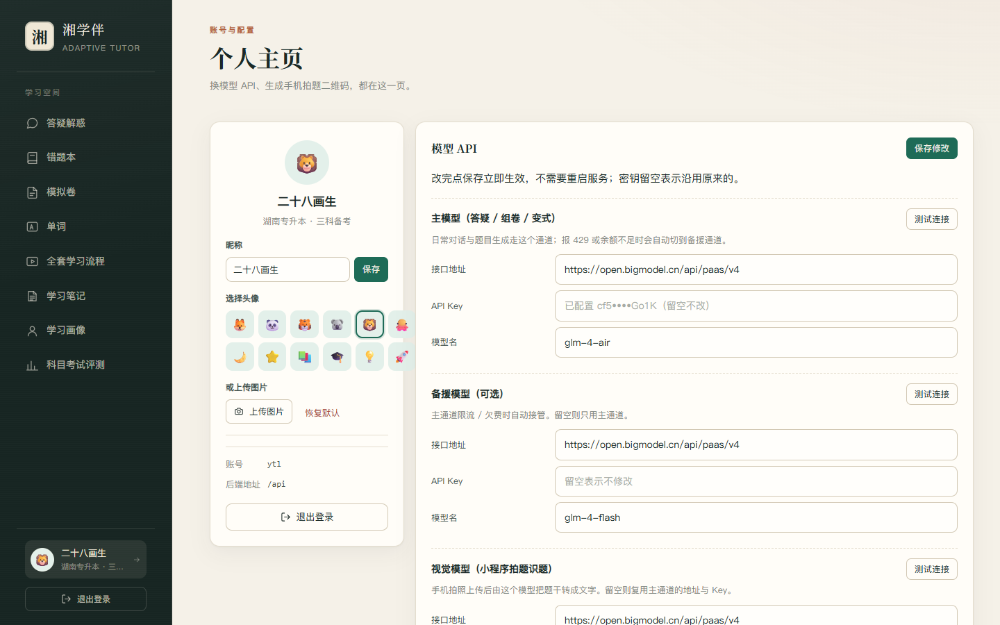 |

| 学单词（视频课目录 + 播放器） | 全套学习流程（三阶段备考） |
|---|---|
|  |  |

| 复习单词（教材 10 单元 / 词法 8 类） | 复习单词（词墙 · 四色标记） |
|---|---|
| 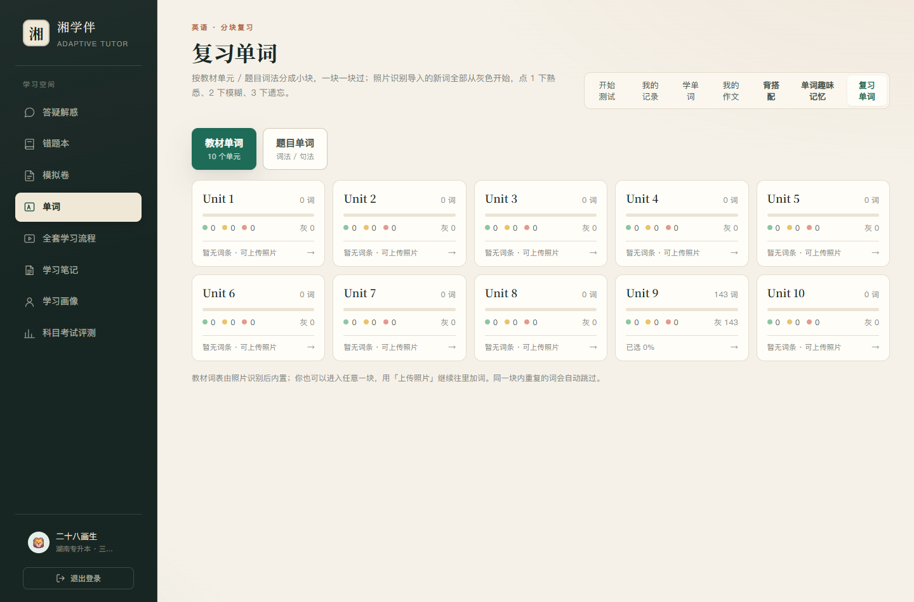 | 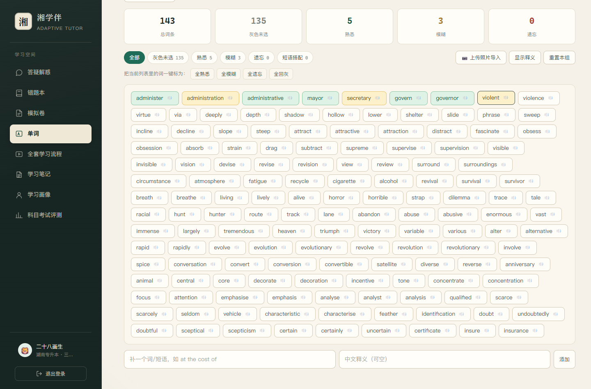 |

| 复习单词（连词和介词 · 含固定搭配） | 复习单词（题目词法 8 分类） |
|---|---|
| 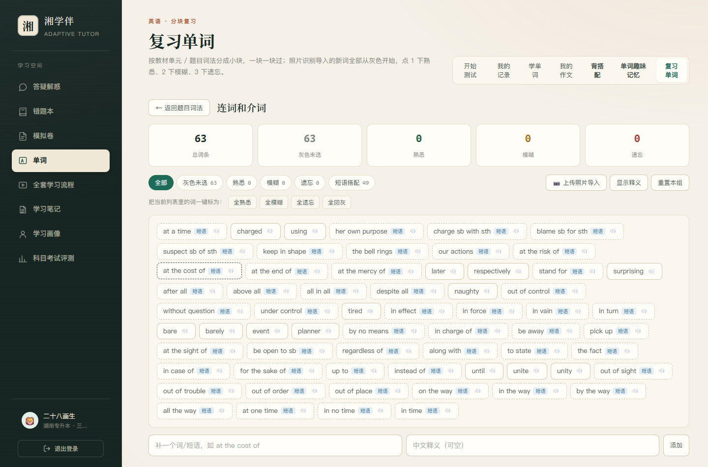 | 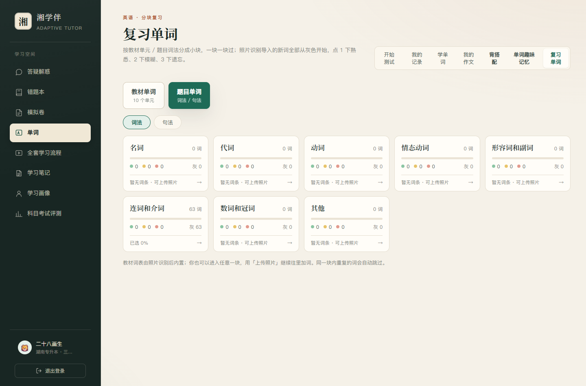 |

---

## 1. 功能一览

| 模块 | 能力 |
|---|---|
| 答疑解惑 | 查询改写 → 向量 + 全文双路召回 → RRF 融合 → Reranker 精排；SSE 流式输出；回答标注 `[出处: …]`；明显超纲时明确提示 |
| 错题本 | 粘贴 JSON / Markdown 自动判格式；指纹判重；三栏浏览；备注逐字保存；状态与作答历史；**打印 / 导出 PDF**：按当前筛选条件拉取全部题目，双栏密集排版，只打印完整题目（题干+选项，不含答案与解析，做完到系统内核对），一页多放题便于自测 |
| 变式闭环 | 后台 2 worker 队列；L1 同类换数 / L2 改问法 / L5 概念辨析；考纲层次仅「了解」时第三题降级为 L1；校验失败自动重试 1 次 |
| 做题小窗 | 做题页右下角「问老师」浮窗；自动携带当前题目/变式上下文；会话落库，可在完整答疑页通过 `?session=<id>` 继续查看 |
| 教师画像 | 数学（严谨步骤）、英语（鼓励式）、计算机（概念-first）三套独立素描卡 |
| 全局画像 | 基础水平 / 目标 / 薄弱考点 / 情绪事件；跨科目共享；最近 7 天情绪事件触发开场安抚 |
| 模拟卷 | 答题卡式机考：模拟（全考纲 22 题 / 150 分 / 120 分钟）与章节（勾选章节、题量时长等比缩放）双模式；原题 + 变式混选、考过自动打标不重复出（可重置）；作答边做边自动保存，到点未交自动按已保存内容强制交卷；填空题整张拍照视觉识别（答案可手改，识别失败保留照片降级为手输），解答题逐题拍照 AI 按步骤评分；手机扫码进 `/m/exam/:id` 拍答题卡实时同步电脑端；结果页分数环 + 逐题判定理由 + AI 改进建议；结果回写 attempts；**打印 / 导出 PDF**：按标准湖南专升本数学试卷版式排版（标题+考生注意事项+一选择题12×5/二填空4×4/三计算6题、题号分值规范、解答题留白、可切空白卷或答案解析卷），模拟真实考试 |
| 评测 | 149 题评测集；基线 / +重排 / +画像 / +错题上下文 四组对比；检索命中率、引用率、回答质量、超纲识别 |
| 单词查漏补缺 | 词表来自《送分笔记·英语》扫描件（OCR 入库）；整屏乱序单词墙，单击=模糊（黄）、连点两下=熟悉（绿）、没点提交后=遗忘（红）；右键弹释义；每轮记录三色数量与时间，下一轮按上轮结果分熟悉/模糊/遗忘三区重测；教师视图可看各学生轮次并导出 CSV；未提交的选择会本地暂存，切页面/刷新回来原样恢复 |
| 学单词（视频课） | 内置刘晓燕单词课 10 个 Unit / 61 节课（`data/刘晓燕单词课`）；左侧目录、右侧播放器，支持拖动进度条与倍速；播放进度按用户记在本地，重开自动续播，看到 95% 记为「已看完」；视频流走 `/api/vocab/course/stream`（Range 分段 + 短时 token 鉴权） |
| 全套学习流程（视频课） | 三阶段备考主线：**库课数学（阶段1，171节）→ 库课英语（阶段2，114节）→ 刘晓燕不背单词（阶段3，61节）**，顶部总览卡展示各阶段课时/体积/完成进度与整体进度，点阶段卡进入目录+播放器；自动扫描 `data/` 下课程目录成通用多级树（加目录即上线，无需改代码），多级折叠 + 课时搜索；播放器支持拖动进度条与倍速，进度按用户记本地、自动续播、看到 95% 记「已看完」；`.qkdownloading` 临时文件自动忽略；视频流走 `/api/lessons/stream`（Range 分段 + token 鉴权）。词课仍可在「单词」页快捷进入 |
| **复习单词（分块记忆）** | 把大词表拆成小块：**教材单词 10 个 Unit** + **题目单词词法 8 类**（名词 / 代词 / 动词 / 情态动词 / 形容词和副词 / 连词和介词 / 数词和冠词 / 其他，句法部分留占位待学）。词条通过**照片上传 → 视觉模型 OCR 识别 → 人工核对**导入，识别后全部初始为灰色，进入小块做第一次选择；复用「灰 → 绿（熟悉）→ 黄（模糊）→ 红（遗忘）」四色记忆法，状态按账号实时保存，支持按颜色筛选、一键批量标记、显示/隐藏释义、点词朗读、重置本组、手动补词，每块独立进度统计 |
| 个人主页（配置） | 点侧边栏用户名进入：改主模型 / 备援 / 视觉 / 向量四组 API，保存后**即时生效**（存 `app_settings` 表覆盖 `.env`，密钥只回显掩码）；每个通道可「测试连接」；手机拍题区显示局域网入口二维码 |
| 手机拍题（局域网网页） | 设置页实时生成指向 `http://<本机IP>:5173/m/snap` 的二维码（`qrcode` 生成，**不会过期**，换 IP 点刷新即可）；手机扫码用浏览器打开移动端页面：登录 → 拍照/相册 → 视觉模型识别（可改错）→ 追问讲解 → 一键存错题本；与微信小程序共用 `/capture/*`、`/chat/*` 接口，数据完全同步。局域网访问时前端自动改用同源 `/api` 走 vite 代理，免 CORS、免改 `.env` |

---

## 2. 目录结构

```
tutor-system/
├─ apps/
│  ├─ server/                  Fastify 后端
│  │  ├─ src/
│  │  │  ├─ config/env.ts      环境变量加载与启动校验
│  │  │  ├─ db/                连接池、迁移执行器、CLI
│  │  │  ├─ routes/            controller 层（只解析请求 / 调服务 / 格式化响应）
│  │  │  ├─ services/          chat / rag / wrongbook / variant / profile / exam / eval / queue / vocab / course
│  │  │  ├─ repos/             参数化 SQL 数据访问
│  │  │  ├─ agent/             Agent Loop、LLM 客户端、工具注册表、Prompt 拼装
│  │  │  ├─ plugins/           鉴权、错误处理
│  │  │  └─ index.ts           启动与优雅停机
│  │  ├─ migrations/           0001 初始结构、0002 源数据兼容
│  │  └─ data/                 组卷规则、英语 / 计算机示例考纲
│  └─ web/                     Vue 3 前端
│     └─ src/{views,components,stores,api,lib,assets}
├─ packages/shared/            前后端共享类型与常量
├─ scripts/
│  ├─ migrate-wrongbook.ts     _archive/wrongbook-legacy → PostgreSQL（幂等）
│  ├─ ingest-kb.ts             知识库 → 切块 → 标注 → embedding → 入库
│  ├─ retag-kb.ts              仅重标考点（不重算向量，支持 --all 全量重标）
│  ├─ check-embed.ts           向量/重排服务冒烟测试
│  ├─ probe-retrieval.ts       检索探针（典型问题 top-k 命中检查）
│  └─ vocab/                   词表流水线（OCR 抽取 → 清洗 → 考纲比对 → 入库，详见其 README）
├─ eval/                       149 题评测集与评测 CLI
├─ data/
│  ├─ kb/                      教材知识库（数学 11 篇 38.5 万字 / 英语 12 篇 37.6 万字，逐页转录）
│  ├─ kp/                      英语 / 计算机示例考纲白名单
│  ├─ 刘晓燕单词课/             单词课视频 10 Unit / 61 节（约 26G，已加入 .gitignore）
│  └─ vocab/                   词表数据源：送分笔记 PDF、教育部课程标准 kc.pdf、
│                              kaogang.json（3040 考纲词）、vocab.json / vocab-extra.json（导入快照）
├─ _archive/                   历史归档（不参与运行）
│  ├─ wrongbook-legacy/        旧版错题本项目（v3，数据已迁移入库，仅留档）
│  └─ kb-legacy-20261116/      知识库重标考点前的备份
├─ .env.example
└─ docker-compose.yml          postgres + pgvector
```

---

## 3. 快速开始

### 3.1 依赖

- Node.js **20+**（开发使用 Node 24）
- PostgreSQL **16** + **pgvector**（本机安装或 `docker compose up -d`）
- 可用的 OpenAI 兼容大模型 API Key（示例配置为智谱 GLM，可换 DeepSeek 等）；Embedding / Reranker Key

Docker 方式：

```bash
docker compose up -d
```

本机 PostgreSQL 方式：确保 `vector` 扩展可用（`CREATE EXTENSION vector;` 成功），并创建数据库 `tutor`。

### 3.2 安装与配置

```bash
npm install
cp .env.example .env
# 编辑 .env：DATABASE_URL、AUTH_USERNAME / AUTH_PASSWORD、LLM_API_KEY、
#          EMBEDDING_API_KEY、RERANK_API_KEY
```

启动时会校验必填项，缺项会打印清单并退出。

### 3.3 初始化数据库

```bash
npm run db:setup          # = npm run migrate + npm run migrate:wrongbook
```

等价于：

```bash
npm run migrate           # 执行 migrations/0001、0002
npm run migrate:wrongbook # 从 F:\wrongbook 导入 56 张卡 + 考纲 + 变式 + 作答
```

迁移脚本默认读取 `F:/wrongbook`，可用 `--dir` 或 `WRONGBOOK_DIR` 覆盖：

```bash
npm run migrate:wrongbook -- --dir D:/wrongbook
```

### 3.4 知识库入库

把 `md / txt / pdf` 放入 `data/kb/<subject>/`（subject = math / english / cs），然后：

```bash
npm run ingest
# 或指定文件 / 关闭 LLM 考点标注
npm run ingest -- --file data/kb/math/01-函数与极限.md --subject math --no-tag
```

同一 `source_name` 重复入库会先删除旧块再写入，脚本幂等。

只用新的模型或提示词重标考点、不重算向量（省 embedding 费用）：

```bash
npx tsx scripts/retag-kb.ts                # 只补空标签
npx tsx scripts/retag-kb.ts --all          # 全量重标，保证标注风格一致
npx tsx scripts/retag-kb.ts --subject math --dry   # 先看待处理数量
```

向量服务需与库中 `vector(1024)` 对齐。当前使用智谱 `embedding-3`（原生 2048 维），
靠 `.env` 的 `EMBEDDING_SEND_DIM=true` 让请求带上 `dimensions=1024`；
换成 bge-m3 这类固定维度模型时把该开关设为 `false`。
接入是否正常可用冒烟脚本确认（会打印维度与同域/跨域相似度对比）：

```bash
npx tsx scripts/check-embed.ts
npx tsx scripts/probe-retrieval.ts
```

### 3.5 开发

```bash
npm run dev
# 后端 http://localhost:8849
# 前端 http://localhost:5173
```

默认账号见 `.env` 的 `AUTH_USERNAME` / `AUTH_PASSWORD`（示例值 `student` / `tutor123`，请自行修改）。

### 3.6 构建与生产

```bash
npm run build             # 后端 tsup + 前端 vue-tsc & vite build
npm run start             # 启动后端 dist/index.js
npm run preview -w @tutor/web
```

前端 API 地址由 `VITE_API_BASE` 控制（默认 `http://localhost:8849/api`）。

---

## 4. 验收对照（开发文档 §12）

| # | 验收项 | 操作 |
|---|---|---|
| 1 | `npm run build` 零错误 | `npm run build`、`npm run typecheck` |
| 2 | 健康检查 / 鉴权 | `curl localhost:8849/health`、`/ready`；不带 token 访问 `/api/subjects` 返回 401；登录后正常 |
| 3 | 迁移 56 题且幂等 | `psql ... -c "select count(*) from questions"` → 56；`variants` 162；`attempts` 35；再次执行迁移数量不变 |
| 4 | 答疑 + 超纲 | 前端提问「数列发散的判断」观察 SSE 与 `[出处: …]`；提问「傅里叶级数」应提示超出考纲 |
| 5 | 错题闭环 | 错题本导入 → 队列进度 → 作答变式 → 尝试记录 → 答疑引用错题 |
| 6 | 降级 | 置空 `RERANK_BASE_URL` 后答疑仍可用，日志含 `rerank_fallback`；`LLM_API_KEY` 无效时 SSE 返回明确中文错误 |
| 7 | 情感路由 | 画像记录「昨日数学受挫」→ 打开英语会话，开场包含安抚话术 |
| 8 | 评测 | 评测页或 `npm run eval -- --limit 20`，输出四组对比表 |

登录并保留 token 的示例：

```bash
TOKEN=$(curl -s -X POST http://localhost:8849/api/auth/login \
  -H 'Content-Type: application/json' \
  -d '{"username":"student","password":"tutor123"}' | node -pe 'JSON.parse(require("fs").readFileSync(0)).accessToken')

curl -N -X POST http://localhost:8849/api/chat/ask \
  -H "Authorization: Bearer $TOKEN" -H 'Content-Type: application/json' \
  -d '{"sessionId":"<会话ID>","content":"数列发散的判断"}'
```

---

## 5. 数据与兼容性说明

- **56 张错题卡全部入库**。源数据中有两张卡共享同一 `fingerprint`（`Q-20261030-017` / `Q-20261030-020`），且部分「了解」层次的变式在同一套 `V1` 内出现两个 `L1`。为同时满足「全部入库 / 字段零丢失」和幂等，迁移 `0002_compat_source_data.sql`：
  - 将 `questions(subject, fingerprint)` 唯一约束降为普通索引（应用层仍按指纹判重）；
  - 变式唯一键改为 `(question_id, dedupe_key)`，`dedupe_key = md5(set_id:level:stem)`。
- 源数据统计：`questions=56`、`variants=162`、`attempts=35`。迁移脚本重跑不会新增数据。
- `data/kp/english.json`、`data/kp/cs.json` 为**示例考纲白名单**（开发文档只提供了数学 62 考点），上线前请替换为湖南省教育考试院最新考纲。数学考纲直接来自 `F:\wrongbook\agent\rules\syllabus.json`。
- `data/kb/` 为示例知识库，用于本地演示检索链路；正式使用请替换为真题、教材与讲义，并重新执行 `npm run ingest`。
- 判定规则：选择题比对选项字母；填空题做归一化 / 数值等价比较；计算题、证明题、应用题与变式题采用 `self_rating` 自评（符合开发文档「证明题不自动判分」的非目标约束）。

---

## 6. Agent Loop 与工具

- 手写循环，最多 5 轮「模型 → 工具 → 模型」；第 5 轮后强制发起一次无工具补全收敛。
- SSE 事件：`start` / `token` / `tool` / `citations` / `done` / `error`。
- 工具：`search_knowledge`、`get_wrongbook_summary`、`add_question`、`generate_variant`、`get_profile`、`update_profile`、`assemble_exam`。
- 做题小窗：`POST /api/chat/ask` 额外接受可选字段 `questionId`、`variantId`、`studentAnswer`，服务端会加载题目/变式，把题干、选项、标准答案、解析与学生当前答案作为「本轮最高优先级上下文」注入 Prompt；回答仍按普通聊天消息落库。完整答疑页支持 `/chat/:subject?session=<id>` 直接定位该会话。
- Prompt 顺序固定：全局设定 → 教师素描卡 → RAG 片段（带 `[出处]`）→ 错题本最近 3 条 → 当前做题上下文（可选）→ 全局画像 + 情绪事件 → 最近 10 轮摘要。
- 消融开关：`RERANK`、`PROFILE_INJECT`、`WRONGBOOK_INJECT`；评测接口可用 `?ablation=rerank,profile,wrongbook_ctx` 覆盖。

---

## 7. 安全与运维

- 结构化 JSON 日志（pino），每请求 `requestId`，Authorization / token / 密钥字段脱敏。
- CORS 白名单、helmet 安全头、登录限流 10 次/分钟。
- JWT access 2h；refresh token 服务端存 SHA-256 哈希，刷新即轮换，旧 token 立即失效。
- 所有 SQL 参数化；错误响应统一 `{"error":{"code","message"}}`，不返回堆栈。
- 前端仅对「先转义、再渲染」的内容使用 `v-html`；KaTeX 渲染失败回退原始文本，不白屏。
- SIGTERM / SIGINT 优雅停机，等待在途请求最多 10 秒。

---

## 8. 已知限制（与开发文档一致）

- 单用户单账号；无多租户与权限体系。
- 证明题、解答题不做自动判分，采用自评。
- PDF 入库按整篇切块，`source_name` 精确到文件；教材转录时已把页首锚点（`【出处：… 书pXX / PDF pXX】`）写进正文，切片命中后可回溯到教材页码，但未建独立页码列。
- 知识库向量维度固定为 1024（与迁移中的 `vector(1024)` 一致），更换 embedding 模型需同步修改迁移。
- 重排（rerank）依赖外部服务；当前所用模型对同域文本打分饱和（0.99~1.0），实测无排序增益，代码内置低区分度检测并自动回退 RRF，默认 `RERANK=false`。
- 评测会真实调用检索与模型，题目越多耗时与费用越高；建议先用 `limit=10~20` 验证链路。

---

## 9. 作业交付说明（安卓 / 移动端）

本项目为 **B/S 架构的 Web 应用**，并非需要安装的原生安卓 APK。安卓手机通过浏览器访问「在线演示」地址即可运行完整功能，这也是当前主流跨平台应用交付方式之一：

- **客户端零安装**：安卓 / iOS / 电脑浏览器打开同一地址即可，响应式布局自动适配手机屏幕。
- **类 App 体验**：手机浏览器「添加到主屏幕」后可全屏运行，图标与原生 App 一致。
- **数据同步**：所有功能（错题、笔记、单词进度、模拟卷）账号隔离、跨设备实时同步。
- **演示素材**：`docs/screenshots/` 目录包含 22 张真实运行截图，覆盖全部核心模块（含视频课目录与播放器、复习单词分块记忆），可直接用于作业展示。课程视频（约 200G）不入库，仅以截图展示。

如需打包为独立 APK，可在不影响现有代码的前提下用 Capacitor / WebView 容器套壳（前端构建产物 + 后端 API 地址指向线上服务），本仓库代码无需改动即可适配。

> 仓库不含任何 API Key、数据库或大体积课程视频（均已加入 `.gitignore`）。`$ cp .env.example .env` 后填入自有密钥即可本地运行。
